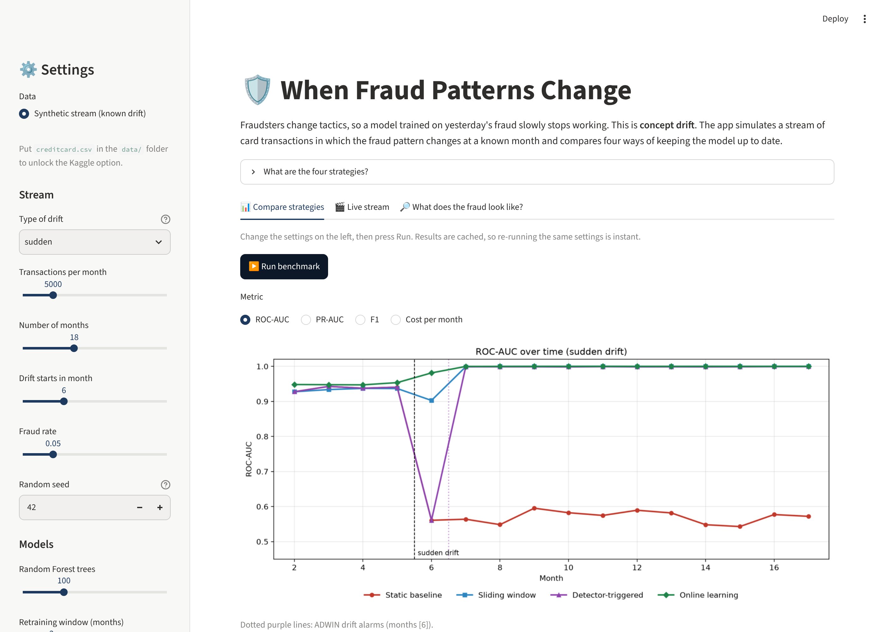

# When Fraud Patterns Change

**Benchmarking drift adaptation methods for financial transactions**
M.Sc. thesis project, Big Data Science, Kozminski University (Kacper Matejczuk)

Fraudsters keep changing their tactics, so a fraud model trained on last year's fraud slowly stops
working. This is called **concept drift**. This project compares four ways of keeping a fraud model up to
date, measuring detection quality, recovery time and cost in euro, on two kinds of data:

- a **synthetic stream** in which the fraud pattern changes at a moment we choose (controlled experiment), and
- **real e-commerce transactions** from the IEEE-CIS Fraud Detection dataset (Vesta Corporation), where fraud
  changes naturally.



---

## Quick start (Windows and macOS)

**1. Install Python 3.13** (3.12 or 3.14 also work) from <https://www.python.org/downloads/>.
On Windows, tick **"Add python.exe to PATH"** in the installer.

**2. Get the project.** On GitHub, click **Code → Download ZIP** and unzip it, or run:

```bash
git clone https://github.com/kacekk/Fraud-Detection-with-Drift-Master-s-project.git
```

**3. Start it.**

| | |
|---|---|
| **Windows** | double-click `start_windows.bat` |
| **macOS** | double-click `start_mac.command` (the first time: right-click → **Open**, because macOS asks about downloaded scripts) |
| **Any system, from a terminal** | `python run.py` (on macOS: `python3 run.py`) |

The first start creates a private environment in the `.venv` folder and installs the exact package
versions (takes a few minutes, once). After that the app opens in your browser within seconds.
Nothing is installed outside the project folder. To remove everything, delete the folder.

> If macOS says the file is not executable, open Terminal in the folder and run `chmod +x start_mac.command`
> once, or simply use `python3 run.py`.

### Other commands

```bash
python run.py               # interactive app (default)
python run.py notebook      # thesis notebook in JupyterLab
python run.py experiment    # full benchmark -> saves CSVs, charts and run_info.json to results/
python run.py experiment --ieee   # the same on the real IEEE-CIS data (after downloading it)
python run.py test          # automated tests, including the reproducibility check
```

The same commands work with the double-click files from a terminal, e.g. `start_windows.bat notebook`.

---

## How the detection works

### 1. Data: a transaction stream with a known change in fraud

The transactions are **synthetic**: they are generated by the project's own code ([`fraud_drift/data.py`](fraud_drift/data.py)), not taken from a bank, so no real customer data is involved. Simulating the data is what makes the experiment possible: we decide exactly when and how fraud changes, so we can measure how quickly each strategy recovers. The same seed always produces the same stream.

Every month has the same number of card transactions (default 5,000; 18 months; 5% fraud) with five
features: `amount`, `hour`, `n_txn_1h` (transactions in the last hour), `foreign` (foreign merchant) and
`device_new` (new device). Normal customers never change. Only what fraud looks like changes:

| | Fraud pattern |
|---|---|
| **A (old)** | large amounts, late at night (00:00–04:59) |
| **B (new)** | small amounts in rapid bursts, foreign merchant, new device |

Three types of drift are simulated (Gama et al., 2014; Lu et al., 2019):

- **sudden**: A switches to B from one month to the next
- **gradual**: B takes over step by step over several months
- **recurring**: B appears, and later A comes back

Because the drift is injected, we know exactly when it happened, which makes it possible to measure
how long each method needs to recover.

### 1b. Real data: IEEE-CIS Fraud Detection

The same four strategies also run on **590,540 real e-commerce card transactions** (Vesta Corporation,
IEEE-CIS competition on Kaggle, 2019; about 3.5% fraud, roughly six months). The timeline is cut into
two-week periods. Real data has no recorded drift moment, so it cannot measure recovery delay, but it shows
whether the ranking and the cost trade-offs found on the synthetic stream hold in practice.

The data needs a Kaggle login, so it is not in this repository. Download steps:
[`data/ieee-cis/README.md`](data/ieee-cis/README.md). After that:

```bash
python run.py experiment --ieee
```

and "IEEE-CIS (real e-commerce)" appears as a data source in the app. The ULB credit-card dataset can be added
as well (see [`data/README.md`](data/README.md)).

### 2. The four strategies

| Strategy | What it does | Type |
|---|---|---|
| **Static baseline** | Random Forest trained once on the first two months, never updated | reference |
| **Sliding window** | Random Forest retrained every month on the latest labelled months | blind adaptation |
| **Detector-triggered** | Random Forest retrained only when a drift detector raises an alarm (ADWIN, Bifet & Gavaldà 2007; or DDM, Gama et al. 2004) | informed adaptation |
| **Online learning** | Logistic regression (or Adaptive Random Forest, Gomes et al. 2017) updated after every labelled transaction | continuous |

By default the drift detector watches **only the confirmed fraud cases** (was each fraud caught or
missed?). With 5% fraud, a model that misses every new fraud is still right on about 95% of all
transactions, so the overall error rate barely moves. Watching the fraud cases reacts much faster.
Both options can be compared in the app and the notebook.

**Label delay:** in real banks, fraud is only confirmed weeks later through chargebacks
(Dal Pozzolo et al., 2018). The `label_delay` setting makes models learn only from months whose labels
have arrived.

### 3. Evaluation (no peeking)

Each month is scored **before** the model learns its labels.

- **ROC-AUC** and **PR-AUC**. PR-AUC is the more honest one when fraud is rare.
- **F1** at a 0.5 alarm threshold.
- **Recovery delay**: months after the drift until PR-AUC is back to 80% of its pre-drift level.
- **Retrainings**.
- **Cost in EUR** = value of missed fraud + €15 per false alarm checked + €500 per retraining. All three
  are configurable.

### Results with the default settings (sudden drift, seed 42)

| Strategy | AUC before | AUC after | PR-AUC after | Recovery (months) | Retrainings | Missed frauds | False alarms | Total cost (EUR) |
|---|---|---|---|---|---|---|---|---|
| Static baseline | 0.937 | 0.570 | 0.058 | not recovered | 0 | 3,543 | 1,786 | 111,453 |
| Sliding window | 0.934 | 0.992 | 0.932 | 1 | 16 | 840 | 703 | 61,373 |
| Detector-triggered | 0.937 | 0.962 | 0.904 | 1 | 1 | 881 | 1,256 | 61,006 |
| Online learning | 0.949 | 0.998 | 0.987 | 0 | continuous | 963 | 181 | 67,828 |

All tables and charts for the three drift types are in [`results/`](results/).

---

## Reproducibility: same results every time

Running the same settings again gives **exactly the same numbers**, on Windows, macOS and Linux:

- **One seed controls everything.** The data generator, the Random Forests and the Adaptive Random Forest
  all take their seed from the config (`seed: 42` in [`configs/default.json`](configs/default.json)).
  No step uses unseeded randomness.
- **Thread count does not matter.** Random Forest trees are trained in parallel, but each tree gets its own
  seed derived from the config, and predictions are averaged single-threaded in a fixed order. The tests
  check that the forest gives bit-identical predictions.
- **Pinned package versions** in [`requirements.txt`](requirements.txt). The launcher installs exactly
  these versions.
- **Fingerprints.** Every run saves a hash of all monthly results in `results/<drift>/run_info.json`,
  together with the config and the exact Python and package versions. If the fingerprint matches, the
  run is identical.

| Run (`python run.py experiment`) | Fingerprint |
|---|---|
| sudden | `e86eefc13a1e335b` |
| gradual | `ba3ec70b64ae29d3` |
| recurring | `b64949d3e5205776` |

- **Automatic check on every push.** GitHub Actions runs the tests on Windows, macOS and Linux
  (Python 3.12 and 3.13). The tests verify that results are identical across reruns and match the
  stored fingerprints ([`tests/reference_fingerprints.json`](tests/reference_fingerprints.json)).

---

## Project structure

```
├── app.py                     Streamlit app (compare strategies, live stream, data explorer)
├── run.py                     one-command launcher for Windows / macOS / Linux
├── start_windows.bat          double-click start on Windows
├── start_mac.command          double-click start on macOS
├── run_experiment.py          full benchmark from the command line -> results/
├── configs/default.json       all settings, including the seed
├── fraud_drift/               the shared code (used by app, notebook and script)
│   ├── config.py              ExperimentConfig: every setting in one place
│   ├── data.py                synthetic stream with injected drift + ULB Kaggle loader
│   ├── ieee.py                IEEE-CIS loader (two-week periods, compact feature set, cache)
│   ├── strategies.py          static, sliding window, detector-triggered, online
│   ├── metrics.py             AUC, PR-AUC, F1, recovery delay, cost, fingerprint
│   ├── experiment.py          runs all strategies, builds the summary table
│   └── plotting.py            charts
├── notebooks/
│   ├── fraud_concept_drift.ipynb   thesis notebook (executed, with all outputs)
│   └── build_notebook.py           regenerates the notebook from source
├── results/                   saved results of the default benchmark
├── tests/                     reproducibility and sanity tests
├── data/                      real datasets you download yourself (IEEE-CIS, ULB); not on GitHub
└── .github/workflows/         automatic tests on Windows, macOS and Linux
```

## Changing the experiment

Edit [`configs/default.json`](configs/default.json), or pass options:

```bash
python run.py experiment --drift gradual
python run.py experiment --seed 7
python run.py experiment --config configs/my_settings.json
python run.py experiment --kaggle data/creditcard.csv
python run.py experiment --ieee
```

## Key references

- Bifet, A., & Gavaldà, R. (2007). Learning from time-changing data with adaptive windowing. *SIAM SDM*. https://doi.org/10.1137/1.9781611972771.42
- Dal Pozzolo, A., Boracchi, G., Caelen, O., Alippi, C., & Bontempi, G. (2018). Credit card fraud detection: A realistic modeling and a novel learning strategy. *IEEE TNNLS*. https://doi.org/10.1109/TNNLS.2017.2736643
- Gama, J., Medas, P., Castillo, G., & Rodrigues, P. (2004). Learning with drift detection. *SBIA 2004*. https://doi.org/10.1007/978-3-540-28645-5_29
- Gama, J., Žliobaitė, I., Bifet, A., Pechenizkiy, M., & Bouchachia, A. (2014). A survey on concept drift adaptation. *ACM Computing Surveys*. https://doi.org/10.1145/2523813
- Gomes, H. M., et al. (2017). Adaptive random forests for evolving data stream classification. *Machine Learning*. https://doi.org/10.1007/s10994-017-5642-8
- Lu, J., Liu, A., Dong, F., Gu, F., Gama, J., & Zhang, G. (2019). Learning under concept drift: A review. *IEEE TKDE*. https://doi.org/10.1109/TKDE.2018.2876857
